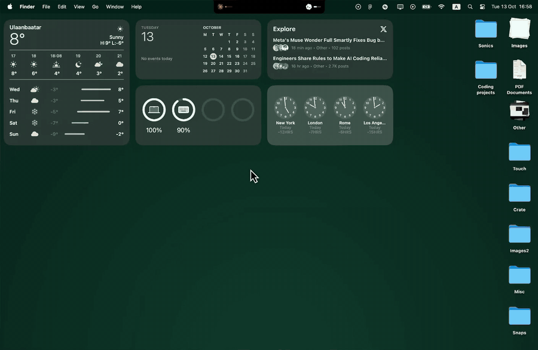

# UsageNotch

Your Claude plan limits, living in the MacBook notch.

[](media/limits.mp4)

<sub>Click the preview for the full quality video.</sub>

UsageNotch extends the notch with a pure black pill. The left side shows the Claude logo and a tiny bar for your 5 hour limit. The right side shows when that limit resets. Click it and it springs open, Dynamic Island style, to show both your 5 hour and weekly limits with the time left until each one resets.

## Features

- **Looks like part of the notch.** Sized from your screen's real notch measurements, with matching corner curves and no hardcoded dimensions.
- **Live numbers.** Refreshes every minute while you're using Claude, every 5 minutes when you're not, and pauses while your Mac sleeps or is locked.
- **Stays out of the way.** Clicking it never steals focus from the app you're in. It stays visible over full screen apps and while switching Spaces.
- **Makes room for long menus.** When the app in front has menus long enough to reach it, Brow slides right so its left edge lines up with the real notch, and everything moves into one pill beside the reset time. This needs the Accessibility permission.
- **Blends into full screen apps.** Over a full screen app's black menu bar, the open pill curves smoothly into the strip, and the soft glow behind each AI's name spills past the pill's edge.
- **Disappears when you don't need it.** No active plan means no pill, as if the app weren't installed.
- **Works without a notch.** On external displays it becomes a floating pill at the top of the screen.
- **No Dock icon.** Right click the pill for Settings and Quit. Opens at login.

## How it gets your usage

There's no official public API for Claude plan limits, so UsageNotch combines three sources and uses whichever is newest:

1. **Anthropic's usage endpoint**, the same one Claude Code's `/usage` command reads, signed in with the login Claude Code already keeps in your Keychain.
2. **A Claude Code status line hook** ([`hooks/statusline.sh`](hooks/statusline.sh)), which saves the official 5 hour and weekly numbers Claude Code passes to its status line after every response in the terminal.
3. **Claude Code's own usage cache** in `~/.claude.json`.

### Privacy

- Your login is only read, never saved or refreshed. It's held in memory until it expires.
- The only network requests go to `api.anthropic.com`. Nothing is sent anywhere else and there are no analytics.
- The endpoint is undocumented and may change. If it does, the pill falls back to the local sources and marks old numbers as "Not updated" instead of crashing.

## Install

You need a MacBook with a notch (or any Mac with the floating pill), macOS 14 or later, Xcode 16, and Claude Code signed in with a Pro or Max plan.

```sh
git clone https://github.com/galzorigo/UsageNotch.git
cd UsageNotch
./install.sh
```

`install.sh` builds the app, copies it to `/Applications` and opens it. It signs the app to run locally, so no Apple Developer account is needed. Run it again any time to update.

The first time UsageNotch reads your Claude Code login, macOS may ask for Keychain access. Choose **Always Allow**.

### Optional: keep permissions between updates

Brow asks for Accessibility access so it can move out of the way of long app menus. An app signed to run locally gets a new signature on every build, and macOS forgets its permissions each time. To avoid that, give it a certificate of its own, once:

1. Open **Keychain Access**, then choose **Keychain Access → Certificate Assistant → Create a Certificate…**
2. Name it **Brow Local Signing**, set **Identity Type** to **Self Signed Root** and **Certificate Type** to **Code Signing**, then click **Create**.
3. Run `./install.sh`. It signs with that certificate from now on. If macOS asks to use the key, choose **Always Allow**.
4. Switch UsageNotch on in **System Settings → Privacy & Security → Accessibility** one last time.

### Optional: the status line hook

The hook keeps your numbers fresh even while you're offline, if you use Claude Code in the terminal:

```sh
mkdir -p ~/.claude/usagenotch
cp hooks/statusline.sh ~/.claude/usagenotch/
```

Then add this to `~/.claude/settings.json`:

```json
"statusLine": { "type": "command", "command": "~/.claude/usagenotch/statusline.sh" }
```

It also gives Claude Code a small status line, for example `Opus · 5h 23% · 7d 41%`.

## Using it

| To | Do this |
| --- | --- |
| See details | Click the pill. Click again or anywhere else to close it. |
| Open Settings | Right click the pill, or open UsageNotch from Spotlight while it's running |
| Quit | Right click the pill, then Quit UsageNotch |
| Stop opening at login | Settings, then switch off Open at login |
| Let it move aside for long menus | Settings, then Allow next to Make room for long menus, and switch UsageNotch on in Accessibility |

## Good to know

- To stay visible while you switch Spaces, the pill uses private macOS window APIs. That's fine for an app you build yourself, but it couldn't ship on the App Store and could break in a future macOS update.
- Codex support is designed in but not connected yet. Providers are pluggable, so adding one only means writing one more [`UsageProvider`](UsageNotch/Providers/UsageProvider.swift).

## Project layout

| File | What it does |
| --- | --- |
| `NotchGeometry.swift` | Measures the notch from the screen |
| `NotchPanel.swift` | The floating window, open and close, show and hide |
| `NotchView.swift`, `ProviderSection.swift` | The pill and the expanded view |
| `NotchShape.swift` | The notch outline with its curved corners |
| `Theme.swift` | Colors, sizes and animation timings |
| `Providers/` | Where usage numbers come from |
| `Settings.swift` | Settings window and open at login |
